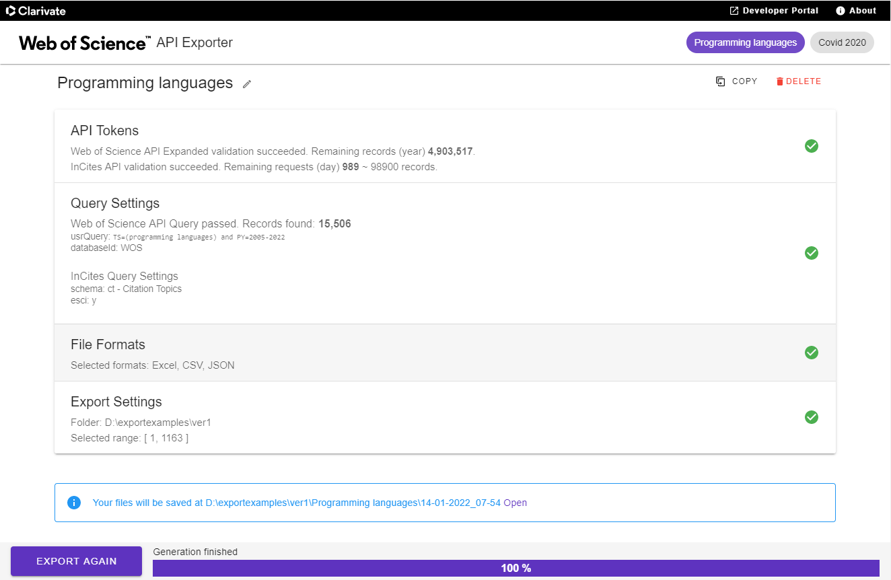

# Web of Science API Exporter



### About This Tool

This tool helps you convert and export Web of Science data from APIs into Excel or CSV files. It works with the Web of Science API Expanded and InCites API. Please note that these APIs require a paid license. To learn more about subscriptions, visit the Developer Portal or contact Web of Science Support.

### Why We Built It

The Web of Science API Product Team created this tool to make it easier for API users to work with data in a structured, table-based format. The exported files can be easily used for reporting, visualization, or integration with data analytics platforms. The tool is free and open-source under the GPL-3.0 license.

### Get Involved

Although the Web of Science API Product Team maintains the tool, we welcome contributions from the community! If you find an issue or have an idea for a new feature, please report it on GitHub instead of contacting Clarivate Support. The tool is built with Electron, TypeScript, and Vue. If you are familiar with these technologies, feel free to submit a pull request with your improvements or ideas. Your contributions are highly appreciated! Download and Install:

- [Windows](https://github.com/clarivate/wos-excel-converter/releases/download/v1.0.0-rc4/wos-api-exporter-setup-1.0.0-rc4.exe)
- [Mac](https://github.com/clarivate/wos-excel-converter/releases/download/v1.0.0-rc4/wos-api-exporter-1.0.0-rc4.dmg)
- [Linux tar.gz](https://github.com/clarivate/wos-excel-converter/releases/download/v1.0.0-rc4/wos-api-exporter-1.0.0-rc4.tar.gz)

### License

Copyright (C) 2021 Web of Science(tm) - Clarivate Analytics

This program is free software: you can redistribute it and/or modify it under the terms of the GNU General Public License as published by the Free Software Foundation, either version 3 of the License, or (at your option) any later version.

This program is distributed in the hope that it will be useful, but WITHOUT ANY WARRANTY; without even the implied warranty of MERCHANTABILITY or FITNESS FOR A PARTICULAR PURPOSE. See the GNU General Public License for more details.

You should have received a copy of the GNU General Public License along with this program. If not, see <https://www.gnu.org/licenses/>.

> **Note**: your use cases must comply with Web of Science product terms, as this tool does not intend to replace or modify them in any way.

### Testing (Playwright + Token Secrets)

- Core E2E tests (no live API tokens required):

```bash
npm run test:e2e:core
```

- Live token E2E tests (requires local env values):

```bash
npm run test:e2e:tokens
```

- Full E2E run:

```bash
npm run test:e2e
```

Create a local `.env` file (this file is gitignored) for token-backed tests:

```env
WOS_EXPANDED_TOKEN=your_wos_expanded_token
INCITES_TOKEN=your_incites_token
```

GitHub Actions workflow is in `.github/workflows/playwright.yml` and runs:

- Core tests on macOS, Windows, Linux
- Token-required tests only when repository secrets are configured:
  - `WOS_EXPANDED_TOKEN`
  - `INCITES_TOKEN`
